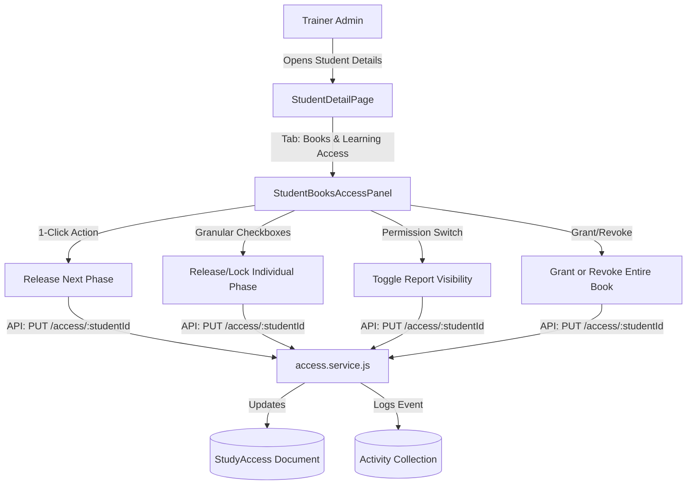
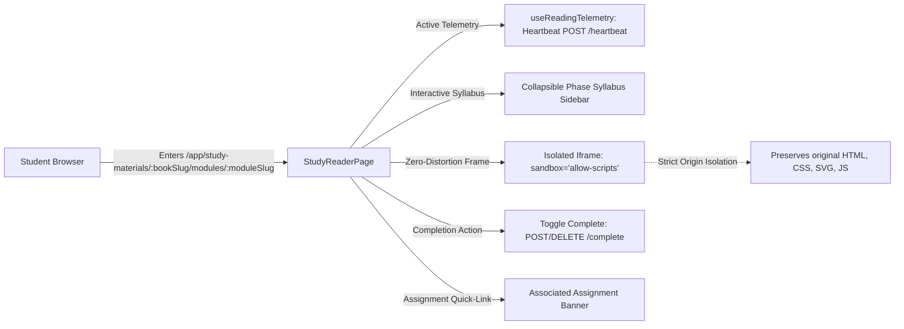

# Phase 9: LMS Books Library, Individual Student Access, Phase Releases & Learning Progress

## 1. Executive Summary

Phase 9 extends the Full-Stack Training LMS with an enterprise-grade HTML study books library, immutable educational content serving, granular per-student access management, sequential phase releases, sandboxed rendering, reading telemetry, linked assignment workflows, and multi-student analytics.

All 34 original HTML source modules across 3 book curricula were audited, hashed with SHA-256, and preserved with 100% byte fidelity without altering a single character of original code or explanation.

### Verification Status
- **Automated Test Suites**: 888 passing tests across both client and server:
  - **Server Tests**: 37 test files, 653 tests passed (0 failures).
  - **Client Tests**: 26 test files, 235 tests passed (0 failures).
- **Code Quality**: ESLint audit passed with 0 errors and 0 warnings.
- **Production Build**: Vite production client build completed in 3.94s with all deploy and secret checks passing.
- **Source Integrity**: Working tree for `content/study-materials` verified clean (`git status` confirms 0 modifications).

---

## 2. Immutable Source Material Preservation

Treating original educational material as immutable is a foundational security and pedagogical requirement. Original HTML books often contain intricate CSS layouts, inline SVGs, script examples, and inter-page structures that must remain untouched.

### Inventory Summary
The complete inventory, file sizes, and cryptographic signatures are recorded in [docs/phase-reports/phase-9-source-inventory.md](file:///d:/My%20work/My-Sass-Products/LMS/docs/phase-reports/phase-9-source-inventory.md):
- **DSA with JavaScript** (`DSA-Study-Material-in_JS`): 9 HTML modules (Modules 1–9) covering Big-O notation through dynamic programming.
- **JavaScript All Phases** (`JavaScript-All`): 8 HTML files (Phases 1–7 + 1 duplicate mirror: `Javascript-Phase-2.html`).
- **React JS Study Material** (`ReactjsStudy-Material`): 17 HTML files (Phases 1–15 + 3 duplicate mirrors: `React-phase-3.html`, `phase-5-React.html`, `phase-12.html`, and 1 fragment: `Phase-10-Reactjs.html`).

### Source Integrity Guarantees
1. **Zero File Modification**: No formatting, tag restructuring, or asset rewriting was performed on disk.
2. **Dynamic Fragment Ingestion**: React Phase 10 (`Phase-10-Reactjs.html`), which is an HTML fragment missing doctype and stylesheet references, is resolved dynamically at response streaming time in `readSourceHtml` by injecting the companion Phase 9 style block without altering the authoritative disk file.
3. **Duplicate Handling**: Mirror files (e.g. `Javascript-Phase-2.html`) are flagged during ingestion and seeded as `draft`, ensuring student navigation remains clean and deduplicated.

---

## 3. Secure Book Import Pipeline

A standalone, zero-dependency ZIP decompression and book ingestion service was built in [server/src/services/studyBookImport.service.js](file:///d:/My%20work/My-Sass-Products/LMS/server/src/services/studyBookImport.service.js) and exposed via CLI script [server/src/scripts/import-study-books.js](file:///d:/My%20work/My-Sass-Products/LMS/server/src/scripts/import-study-books.js).

### Security Defenses
- **Zip Slip Mitigation**: `validateSafeZipPath` normalizes all relative entry paths and rejects paths containing `..`, absolute paths (`/` or `C:\`), and null bytes.
- **Decompression Bomb Protection**: Strict cumulative extraction quotas enforce a 120 MB ceiling and reject individual file compression ratios exceeding 100:1 for files larger than 100 KB.
- **Symlink Traversal Rejection**: Rejects ZIP entries with UNIX symlink attribute bits (`0o120000`).
- **Safe Dry-Run Mode**: Supports `--dry-run` to inspect and validate archives without writing to disk or database.
- **Collision Protection**: Detects duplicate books and existing slugs, refusing to overwrite without an explicit `--force` flag.

### CLI Usage
```bash
# Dry run inspection of study materials directory
npm run import-books -- --dry-run content/study-materials

# Idempotent import of study books
npm run import-books -- content/study-materials
```

---

## 4. Data Models & Schema Evolution

The database schema was evolved using backward-compatible Mongoose models:

### 1. `StudyBook` (`server/src/models/StudyBook.js`)
- `title`: Book display title.
- `slug`: URL-safe identifier (e.g., `dsa-javascript`, `javascript-mastery`, `reactjs-complete`).
- `category`: `dsa` | `javascript` | `react` | `fullstack`.
- `description`: Book description.
- `gradient`: Thematic background gradient for library bookshelf tiles.
- `status`: `draft` | `published` | `archived`.
- `order`: Integer ordering in library.

### 2. `StudyModule` (`server/src/models/StudyModule.js`)
- `book`: Reference to `StudyBook`.
- `title`: Phase or module title.
- `slug`: Unique slug per book.
- `phaseLabel`: Structured label (e.g., `Module 1`, `Phase 4`).
- `originalFilename`: Exact filename on disk.
- `fileSha256`: SHA-256 hash for tamper detection.
- `order`: Sequential phase index.
- `status`: `draft` | `published` | `archived`.
- `estimatedMinutes`: Estimated reading duration.
- `linkedAssignment`: Optional reference to `Assignment` model.

### 3. `StudyAccess` (`server/src/models/StudyAccess.js`)
- `student`: Reference to `User` (student).
- `book`: Reference to `StudyBook`.
- `isBookAssigned`: Boolean indicating whether the student is granted the book.
- `releasedModules`: Array of `StudyModule` ObjectIds representing unlocked phases.
- `canViewReport`: Boolean controlling student progress report visibility (default: `false`).
- `grantedBy`: Reference to admin user who granted access.
- `grantedAt`: Timestamp of grant.

### 4. `StudyProgress` (`server/src/models/StudyProgress.js`)
- `student`: Reference to `User`.
- `book`: Reference to `StudyBook`.
- `module`: Reference to `StudyModule`.
- `totalReadingSeconds`: Cumulative engaged reading duration.
- `lastScrollPosition`: Integer scroll position ratio (0–100).
- `isCompleted`: Boolean completion status.
- `completedAt`: Timestamp when marked complete.
- `firstOpenedAt` / `lastAccessedAt`: Telemetry timestamps.

### 5. `Assignment` (`server/src/models/Assignment.js`)
- Added optional `studyBook` and `studyModule` references with compound indexes `{ studyBook: 1, studyModule: 1 }`.

### 6. `Activity` (`server/src/models/Activity.js`)
- Added `ACTIVITY_TYPES.STUDY_ACCESS_UPDATED` and reference fields `studyBook` and `studyModule`.

---

## 5. Granular Student Access & Sequential Phase Releases

Individual student book access is managed by the trainer from the existing Student Detail Page ([client/src/features/trainer/students/StudentDetailPage.jsx](file:///d:/My%20work/My-Sass-Products/LMS/client/src/features/trainer/students/StudentDetailPage.jsx)) under the dedicated **Books & Learning Access** tab via [StudentBooksAccessPanel.jsx](file:///d:/My%20work/My-Sass-Products/LMS/client/src/features/trainer/students/StudentBooksAccessPanel.jsx).



### Key Administrative Controls
1. **Summary KPIs**: Real-time tiles show assigned books, released modules, total reading duration, and report visibility status.
2. **Book Syllabus Tabs**: Switch between books with release counts and lock indicators.
3. **Sequential "Release Next Phase" Button**: Automatically discovers the student's next unreleased published phase in syllabus order and releases it in a single click (`action: 'release_next'`).
4. **"Release All" & "Lock All" Buttons**: Instantly releases or revokes all published phases for fast cohort provisioning.
5. **Granular Phase Checkboxes**: Toggle individual modules with indicators showing reading duration, completion state, and linked assignment grades.
6. **Student Progress Report Visibility**: Toggle whether the student can view their progress report (`canViewReport`). Defaults to `false` until enabled by the trainer.
7. **Audit Logging**: All access mutations log a `STUDY_ACCESS_UPDATED` activity record for trainer auditing.

---

## 6. Sandboxed HTML Study Reader Architecture

The student reading experience is powered by [client/src/features/study-materials/StudyReaderPage.jsx](file:///d:/My%20work/My-Sass-Products/LMS/client/src/features/study-materials/StudyReaderPage.jsx).



### Security & UX Highlights
- **Strict Sandbox Boundary**: Iframes are configured with `sandbox="allow-scripts"` (strictly omitting `allow-same-origin`). This allows interactive scripts, charts, and syntax examples to run while preventing the embedded content from reading the parent window's storage, cookies, or DOM.
- **Server-Side Access Gate**: `GET /api/v1/study-materials/:bookSlug/modules/:moduleSlug/content` verifies that:
  - The student has an active `StudyAccess` grant for the book.
  - The requested module is included in `releasedModules`.
  - The module and book are published.
  - Any unauthorized attempt returns a 404 (preventing reconnaissance).
- **Collapsible Syllabus Sidebar**: Allows one-click navigation between released phases with checkmarks for completed modules, clock badges for in-progress modules, and lock icons for unreleased phases.
- **Reading Telemetry**: `useReadingTelemetry` tracks engaged window reading time with heartbeat pings and idle pause detection.
- **Linked Assignment Banner**: When a study phase is associated with an assignment, a prominent footer banner displays the assignment title with a direct link to submit work.

---

## 7. Assignment Integration Without Course Enrollment

Traditionally, assignments in the LMS were bound to course enrollments. Phase 9 integrates assignments with study books so students who are granted a book can complete homework problem sets without requiring course enrollment:

- In [server/src/services/access.service.js](file:///d:/My%20work/My-Sass-Products/LMS/server/src/services/access.service.js):
  - `studentAssignmentAccess(user, assignment)` checks if the assignment is linked to a `studyBook` and `studyModule`. If the student has access to the book and the module has been released, access is granted.
  - `assignmentsVisibleTo(user)` includes assignments linked to any released study modules in the student's assignment listings and dashboard.
- Homework problem sets can be linked to study modules directly from the Admin Study Materials Catalogue ([AdminStudyMaterialsPage.jsx](file:///d:/My%20work/My-Sass-Products/LMS/client/src/features/study-materials/admin/AdminStudyMaterialsPage.jsx)) via the "Link Assignment" modal.

---

## 8. Multi-Student Analytics & Progress Reporting

Admin reporting in [server/src/services/studyMaterials.service.js](file:///d:/My%20work/My-Sass-Products/LMS/server/src/services/studyMaterials.service.js) provides real-time cohort visibility:

- **Aggregated Reports**: Breakdown by student, book, assigned phases, completed phases, percentage completion, and total reading time.
- **Subject Filtering**: Filter reports by curriculum subject (`dsa`, `javascript`, `react`).
- **CSV Export**: `GET /api/v1/study-materials/admin/reports/export` generates RFC 4180-compliant CSV downloads with sanitized fields against formula injection.
- **Student Report Visibility Permission**: `GET /api/v1/study-materials/my-report` strictly enforces `canViewReport`. When disabled by the trainer, students receive a `403 Forbidden` error explaining that reports are disabled.

---

## 9. Verification & Automated Test Results

### 1. Server Test Suite (37/37 Test Files, 653/653 Tests Passed)
```
✓ tests/files.test.js (32 tests)
✓ tests/materials.test.js (33 tests)
✓ tests/students-admin.test.js (12 tests)
✓ tests/assignments.test.js (28 tests)
✓ tests/submissions.test.js (29 tests)
✓ tests/study-materials-integrity.test.js (7 tests)
✓ tests/permission-audit.test.js (98 tests)
✓ tests/study-books-import.test.js (8 tests)
✓ tests/study-materials-api.test.js (12 tests)
✓ tests/activity.test.js (6 tests)
✓ tests/study-materials-access-control.test.js (7 tests)
...
Test Files  37 passed (37)
Tests       653 passed (653)
```

### 2. Client Test Suite (26/26 Test Files, 235/235 Tests Passed)
```
✓ src/features/auth/AuthPages.test.jsx (7 tests)
✓ src/features/notifications/Notifications.test.jsx (13 tests)
✓ src/features/trainer/students/Students.test.jsx (7 tests)
✓ src/features/courses/admin/AdminCourses.test.jsx (10 tests)
✓ src/features/study-materials/StudyReaderPage.test.jsx (6 tests)
✓ src/features/trainer/students/StudentBooksAccessPanel.test.jsx (6 tests)
✓ src/features/assignments/student/AssignmentPage.test.jsx (14 tests)
✓ src/routes/routes.test.jsx (37 tests)
✓ src/test/a11yConventions.test.js (2 tests)
...
Test Files  26 passed (26)
Tests       235 passed (235)
```

### 3. Static Code Analysis (ESLint)
```bash
npm run lint
# Output: Exit code 0 (0 errors, 0 warnings across all files)
```

### 4. Production Client Build
```bash
npm run build
# Output: Vite production build succeeded in 3.94s, gzip bundles created in client/dist/
```

### 5. Cryptographic Source Integrity Audit
```bash
git status -- content/study-materials
# Output: nothing to commit, working tree clean (0 files modified)
```

---

## 10. Operational Runbook & Admin Verification Guide

### 1. Granting Book & Phase Access to a Student
1. Sign in as trainer at `/login`.
2. Navigate to **Students** (`/admin/students`) and select a student.
3. Switch to the **Books & Learning Access** tab.
4. Select the desired book tab (e.g. *DSA with JavaScript*).
5. Click **Grant Book Access** to assign the book.
6. Click **Release Next: Module 1** to release the first phase to the student.
7. Verify that the student dashboard and library now display the released module.

### 2. Student Reading & Homework Workflow
1. Sign in as student.
2. Navigate to **My Library** (`/app/study-materials`).
3. Click **Continue Reading** on the assigned book.
4. Verify the sandboxed reader opens with the original HTML styling intact.
5. Toggle the **Syllabus** sidebar to verify that only released modules are accessible.
6. Click **Mark Complete** to track module progress.
7. If an assignment is linked, click **Go to Assignment** in the bottom banner to submit homework.

### 3. Enabling Student Progress Reports
1. In the admin student detail page under **Books & Learning Access**, locate the **Student Progress Report** toggle.
2. Click the button to switch from `Hidden ✕` to `Allowed ✓`.
3. The student can now access `/app/study-materials/report` to view their progress summary.

